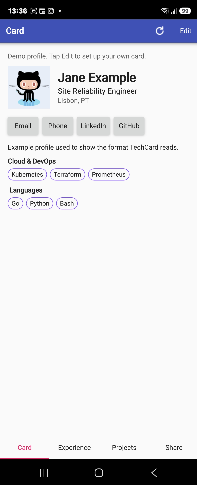
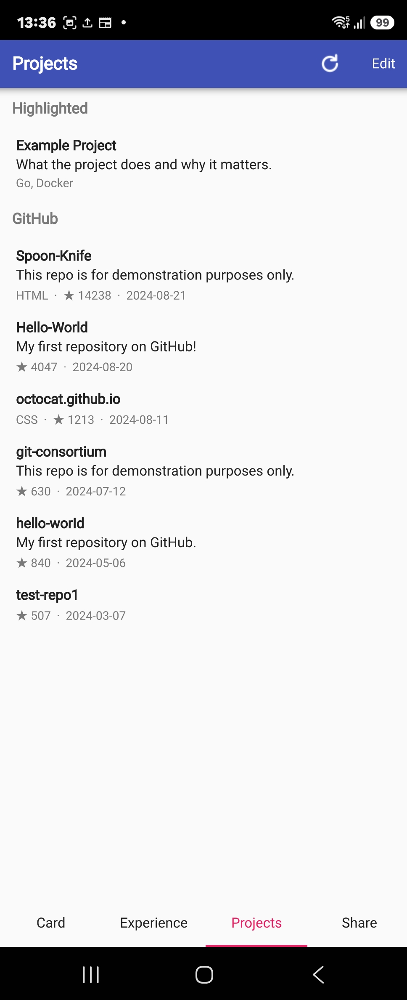
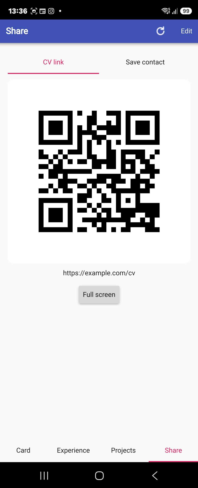
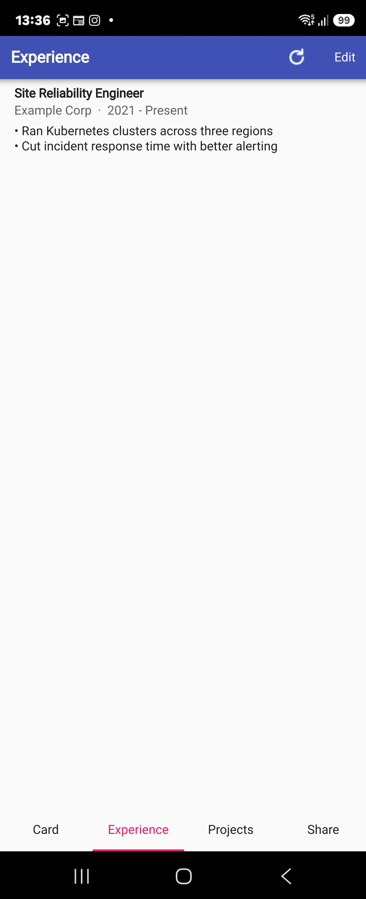
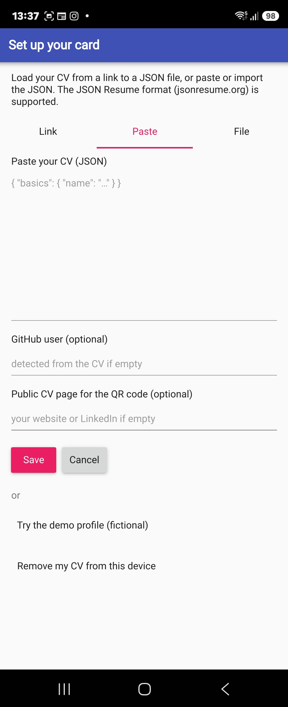
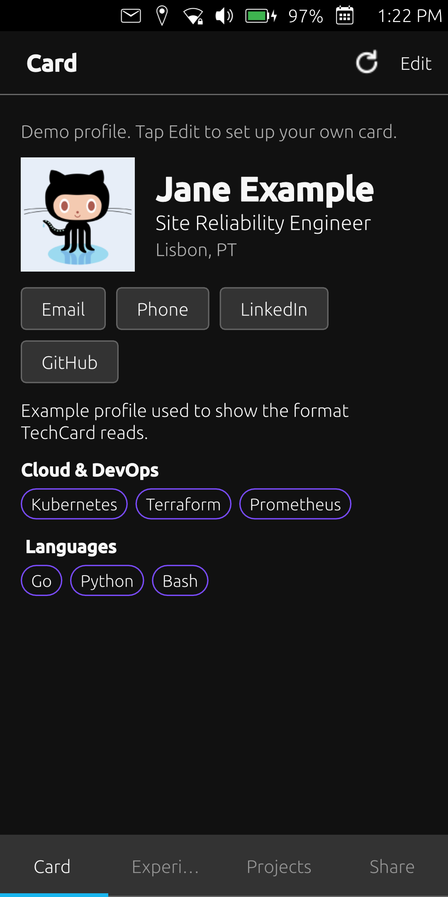
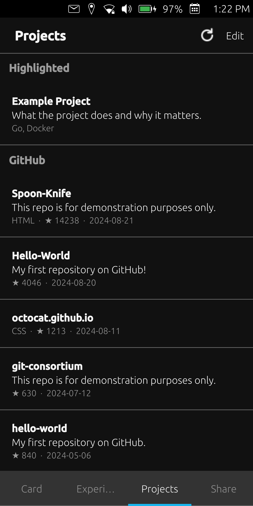
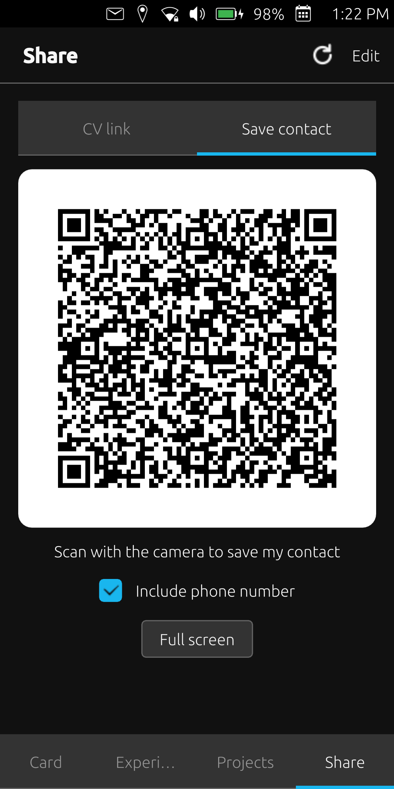

# TechCard

**Your CV as a business card on your phone.** Show your profile, experience and GitHub
projects, and share them with a QR code: one for a link to your CV, one that saves your
contact straight into the other person's phone.

Runs on **Android** and **Ubuntu Touch** from a single Qt/QML code base.

<table>
  <tr><th colspan="3">Android</th></tr>
  <tr>
    <td align="center"><br>Card</td>
    <td align="center"><br>Projects</td>
    <td align="center"><br>Share (QR)</td>
  </tr>
  <tr>
    <td align="center"><br>Experience</td>
    <td align="center"><br>Setup</td>
    <td></td>
  </tr>
  <tr><th colspan="3">Ubuntu Touch</th></tr>
  <tr>
    <td align="center"><br>Card</td>
    <td align="center"><br>Projects</td>
    <td align="center"><br>Share (contact QR)</td>
  </tr>
</table>

<sub>Screenshots use the built-in demo profile (a fictional person).</sub>

## Features

- **Your own CV, three ways**: a link to a JSON file, pasted JSON, or a `.json` file (Android)
- **JSON Resume support**: reads the open [JSON Resume](https://jsonresume.org/schema) format
- **Card**: avatar, name, title, location, contact buttons, summary and skills
- **Experience**: roles, companies, periods and highlights
- **Projects**: projects from your CV plus your public GitHub repositories
- **Share by QR code**
  - *CV link*: opens your public CV page in any phone's browser
  - *Save contact*: a vCard that the camera app offers to add to contacts (phone number optional)
  - full-screen mode for showing it across the table
- **Works offline**: the last CV and repositories are kept on the device
- **Private**: no account, no tracking; your data stays on your phone and your own server
- **Demo profile** to try the app before setting it up

## Getting started

1. Install the app (see [Build](#build); store releases are planned).
2. On first start, choose where your CV comes from:

   | Option | Use it when |
   |---|---|
   | **Link** | Your CV JSON is online: a GitHub Gist ("Raw" link), GitHub Pages or your own server. Refreshed every time the app opens. |
   | **Paste** | You want to paste the JSON directly. It is stored on the device. |
   | **File** | You have a `.json` file on the phone (Android only). It is stored on the device. |

3. Optional:
   - **GitHub user**: whose public repositories to show. If empty, it is taken from the GitHub
     profile in your CV.
   - **Public CV page**: the link in the "CV link" QR code. If empty, `basics.url` or your
     LinkedIn profile is used.

Change these at any time with **Edit**. **Remove my CV from this device** deletes everything.

### CV format

TechCard reads [JSON Resume](https://jsonresume.org/schema). A minimal example is in
[`docs/example-resume.json`](docs/example-resume.json) (it is also the demo profile):

```json
{
  "basics": {
    "name": "Jane Example",
    "label": "Site Reliability Engineer",
    "email": "jane@example.com",
    "url": "https://example.com/cv",
    "profiles": [
      { "network": "LinkedIn", "url": "https://www.linkedin.com/in/jane-example" },
      { "network": "GitHub", "username": "octocat" }
    ]
  },
  "work": [ { "name": "Example Corp", "position": "SRE", "startDate": "2021-02-01",
              "highlights": ["Ran Kubernetes clusters across three regions"] } ],
  "skills": [ { "name": "Cloud & DevOps", "keywords": ["Kubernetes", "Terraform"] } ],
  "projects": [ { "name": "Example Project", "description": "What it does",
                  "keywords": ["Go"], "url": "https://github.com/octocat/Hello-World" } ]
}
```

Many CV tools can export JSON Resume. You only need a public link to the file, or you can
paste it into the app.

### Privacy

TechCard only reads the CV you point it to and the public GitHub API. Settings and cached
data are stored in the app's private storage (`~/.config/techcard.sandrrei` and
`~/.local/share/techcard.sandrrei` on Ubuntu Touch). Keep in mind that anything in a public
CV link (such as your phone number) is visible to anyone with that link.

## Build

Requirements:

- **Ubuntu Touch**: [Clickable](https://clickable-ut.dev) (uses Docker, no local Qt needed)
- **Android**: Qt 5.15.2 for Android, JDK 11, Android SDK with **platform android-30 and
  build-tools 30.0.3 only** (newer versions break Qt 5.15's Gradle plugin), NDK r21e
  (21.4.7075529), and [KDAB android_openssl](https://github.com/KDAB/android_openssl) in
  `~/Android/Sdk/android_openssl` (HTTPS does not work without it)

The helper script does the rest:

```bash
./build.sh android     # build the APK and install it on the connected Android phone
./build.sh ut          # build, install and start on the connected Ubuntu Touch phone
./build.sh desktop     # run the Ubuntu Touch version on the PC
./build.sh             # list all commands (logs, clean, ...)
```

On Android the app is installed as **TechCard** (`com.sandrrei.techcard`). The first Android
build creates `android/AndroidManifest.xml` from Qt's template; the script then sets the app
name, package id, icon and version (from `CMakeLists.txt`) on every build.

<details>
<summary>Manual Android build (without the script)</summary>

```bash
cmake -S . -B build-android -G Ninja \
  -DCMAKE_TOOLCHAIN_FILE=$ANDROID_SDK_ROOT/ndk/21.4.7075529/build/cmake/android.toolchain.cmake \
  -DANDROID_ABI=arm64-v8a -DANDROID_NATIVE_API_LEVEL=21 -DANDROID_STL=c++_shared \
  -DANDROID_SDK=$ANDROID_SDK_ROOT \
  -DCMAKE_PREFIX_PATH=$HOME/Qt/5.15.2/android \
  -DCMAKE_FIND_ROOT_PATH=$HOME/Qt/5.15.2/android \
  -DCMAKE_BUILD_TYPE=Debug
cmake --build build-android                 # build the app library first
cmake --build build-android --target apk    # then package the APK
adb install -r build-android/android-build/build/outputs/apk/debug/android-build-debug.apk
```

Without `build.sh`, the app keeps Qt's default name and package id unless
`android/AndroidManifest.xml` exists.
</details>

### Icon

`assets/logo.svg` is the source. After changing it, regenerate the Android icons:

```bash
for d in mdpi:48 hdpi:72 xhdpi:96 xxhdpi:144 xxxhdpi:192; do
  rsvg-convert -w ${d##*:} -h ${d##*:} assets/logo.svg -o android/res/mipmap-${d%%:*}/ic_launcher.png
done
```

## Project layout

```
CMakeLists.txt        shared build (Ubuntu Touch via Clickable, Android via CMake)
build.sh              build / install / logs helper
clickable.yaml        Clickable config
manifest.json         click manifest (app id techcard.sandrrei)
techcard.apparmor     AppArmor policy (networking)
techcard.desktop      launcher entry
src/                  C++: DataStore (config, network, cache, JSON Resume), QrCodeItem
src/third_party/      Nayuki QR Code generator
qml/                  UI: Main, Setup, Card, Experience, Projects, Share
android/res/          Android launcher icons
assets/logo.svg       app icon
docs/                 example CV and screenshots
```

## Roadmap

- Signed release APK on GitHub Releases, then IzzyOnDroid
- Ubuntu Touch release on the OpenStore
- PDF export of the CV

## License

MIT, see [LICENSE](LICENSE). QR codes are generated with
[QR Code generator](https://www.nayuki.io/page/qr-code-generator-library) by Project Nayuki (MIT),
in `src/third_party/`.
